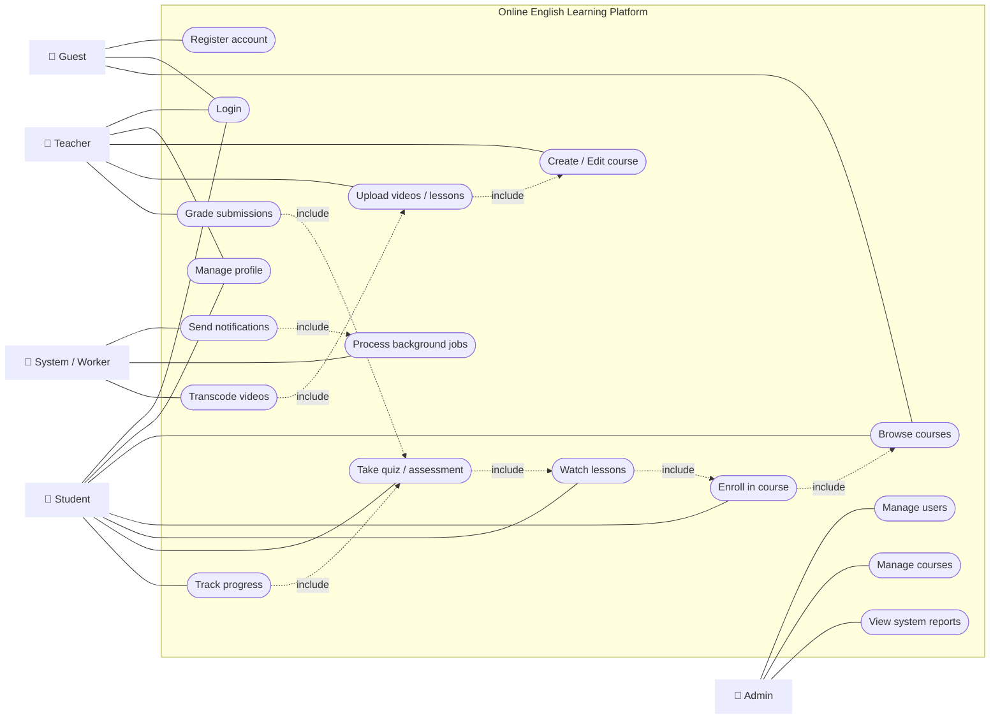
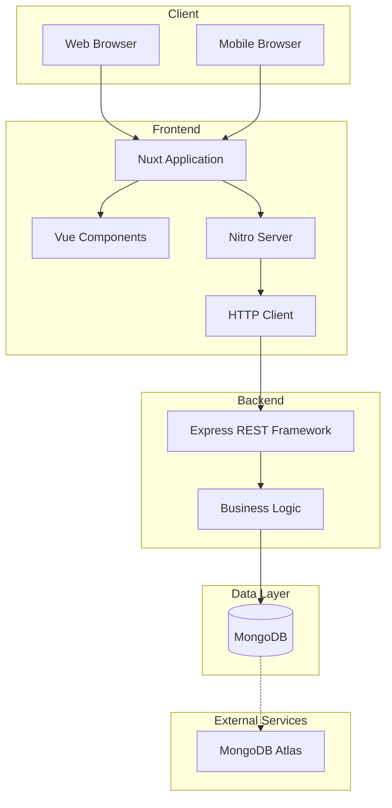
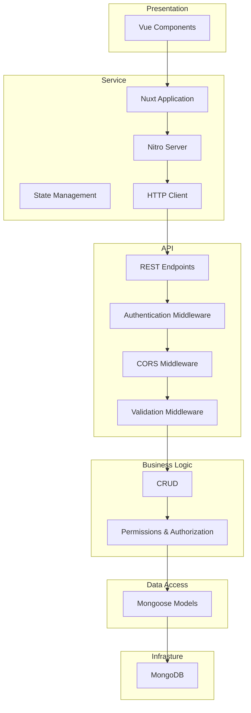
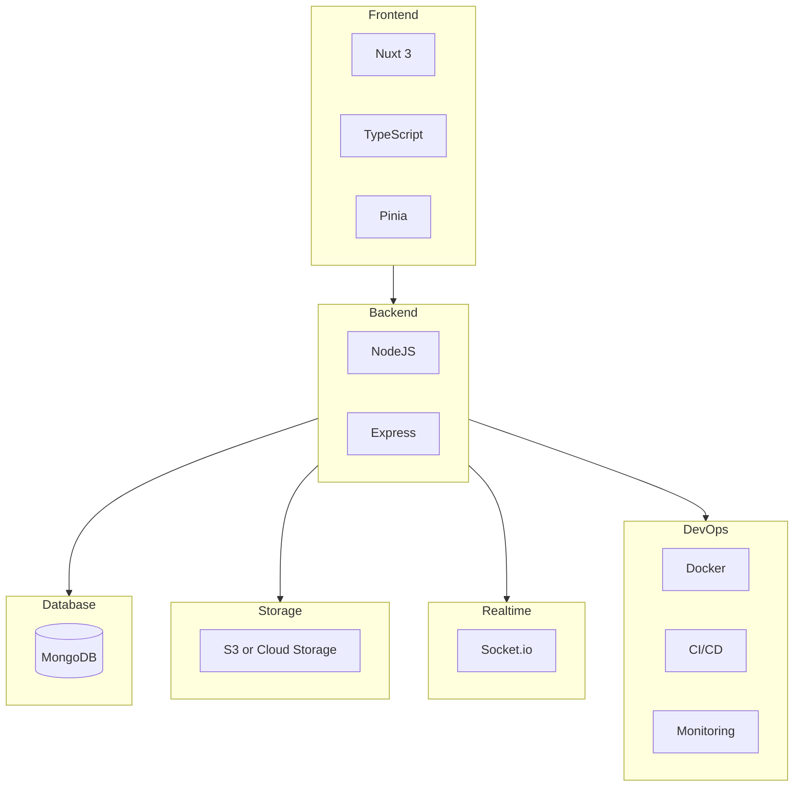
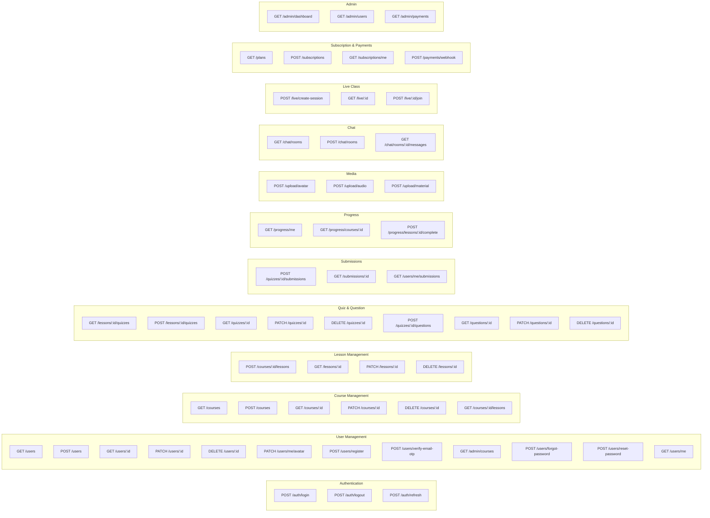
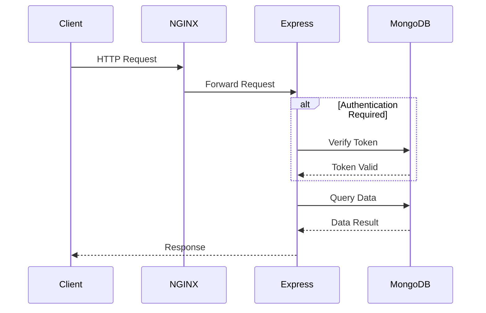

# Tài liệu kiến trúc hệ thống

Tài liệu này mô tả kiến trúc tổng thể của hệ thống, bao gồm các thành phần chính,
cách chúng tương tác với nhau, và các nguyên tắc thiết kế cơ bản.

## Mục lục

---

## Tổng quan

To-do: Viết phần tổng quan về hệ thống, mục tiêu và phạm vi của tài liệu kiến trúc.

---

## Sơ đồ Use-case



---

## Kiến trúc hệ thống

### Kiến trúc cấp cao



### Các lớp kiến trúc



---

## Các công nghệ chính



---

## Lược đồ cơ sở dữ liệu

```mermaid
erDiagram

  USER {
    ObjectId _id PK
    string username UK
    string email UK
    bool isEmailVerified
    string password
    string fullName
    string role
    string profilePictureUrl
    date createdAt
    date updatedAt
  }

  SESSION {
    ObjectId _id PK
    ObjectId userId FK
    string refreshTokenHash
    string ipAddress
    string userAgent
    string deviceInfo
    bool revoked
    date revokedAt
    date expiresAt
    date createdAt
    date updatedAt
  }

  OTP {
    ObjectId _id PK
    ObjectId userId FK
    string otpHash
    string verificationToken UK
    string otpType
    bool used
    date createdAt
  }

  MEDIA {
    ObjectId _id PK
    string url
    string type
    ObjectId ownerId FK
    date createdAt
  }

  COURSE_CATEGORY {
    ObjectId _id PK
    string name
    string description
    date createdAt
  }

  COURSE {
    ObjectId _id PK
    string title
    string description
    string thumbnail
    ObjectId authorId FK
    ObjectId categoryId FK
    string level
    string status
    ObjectId[] lessonIds
    ObjectId[] classIds
    date createdAt
    date updatedAt
  }

  CLASS {
    ObjectId _id PK
    string name
    ObjectId courseId FK
    ObjectId teacherId FK
    ObjectId[] studentIds
    string room
    string description
    number maxStudents
    string status
    date startDate
    date endDate
    date openedAt
    date endedAt
    date createdAt
    date updatedAt
  }

  TIME_TABLE {
    ObjectId _id PK
    ObjectId classId FK
    number dayOfWeek
    date startTime
    date endTime
    string description
    date createdAt
    date updatedAt
  }

  ENROLLMENT {
    ObjectId _id PK
    ObjectId userId FK
    ObjectId courseId FK
    string status
    number price
    number paidPrice
    string paidMethod
    number progressPercentage
    date enrolledAt
    date completedAt
    date createdAt
    date updatedAt
  }

  PROGRESS {
    ObjectId _id PK
    ObjectId userId FK
    ObjectId courseId FK
    ObjectId[] completedLessonIds
    number percentage
    date updatedAt
  }

  USER ||--o{ SESSION : has
  USER ||--o{ OTP : for_verification
  USER ||--o{ MEDIA : owns
  USER ||--o{ COURSE : creates
  USER ||--o{ CLASS : teaches
  USER ||--o{ ENROLLMENT : enrolls_in
  USER ||--o{ PROGRESS : tracks

  COURSE ||--o{ COURSE_CATEGORY : belongs_to
  COURSE ||--o{ CLASS : has_classes
  COURSE ||--o{ ENROLLMENT : has_enrollments
  COURSE ||--o{ PROGRESS : progress_in

  CLASS ||--o{ TIME_TABLE : has_schedule
  CLASS ||--o{ USER : has_students

  ENROLLMENT ||--o{ PROGRESS : tracks_progress
```

---

## Mô hình API

### RESTful API Endpoints



### BFF Endpoints

To-do: Cập nhật sau

### Luồng giao tiếp chính



---
