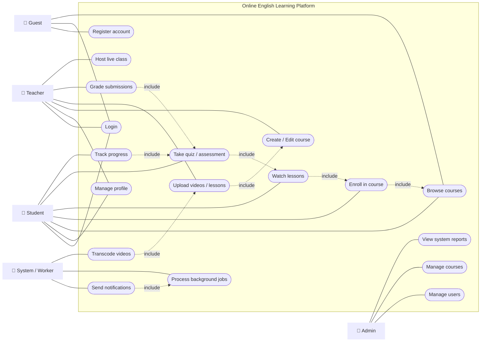
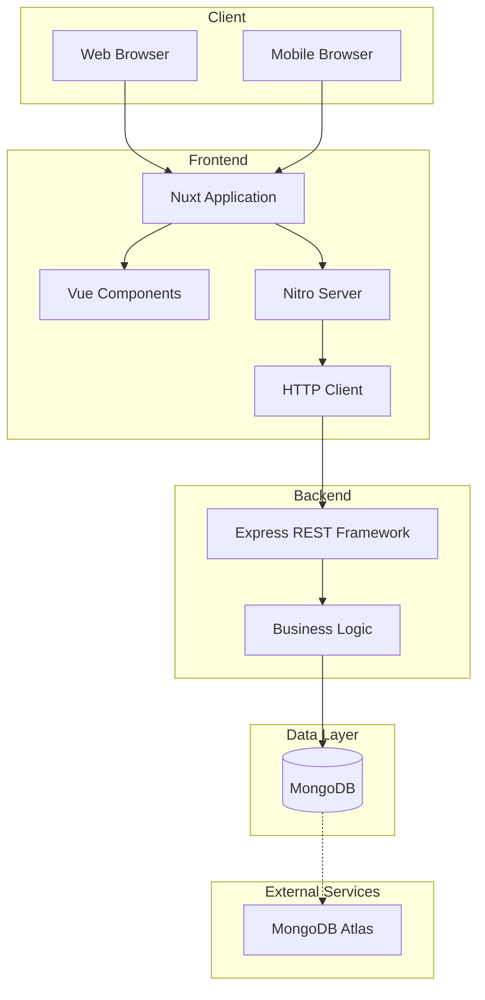
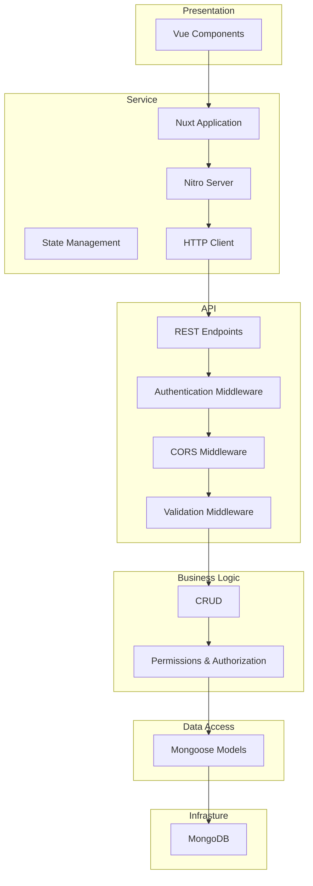
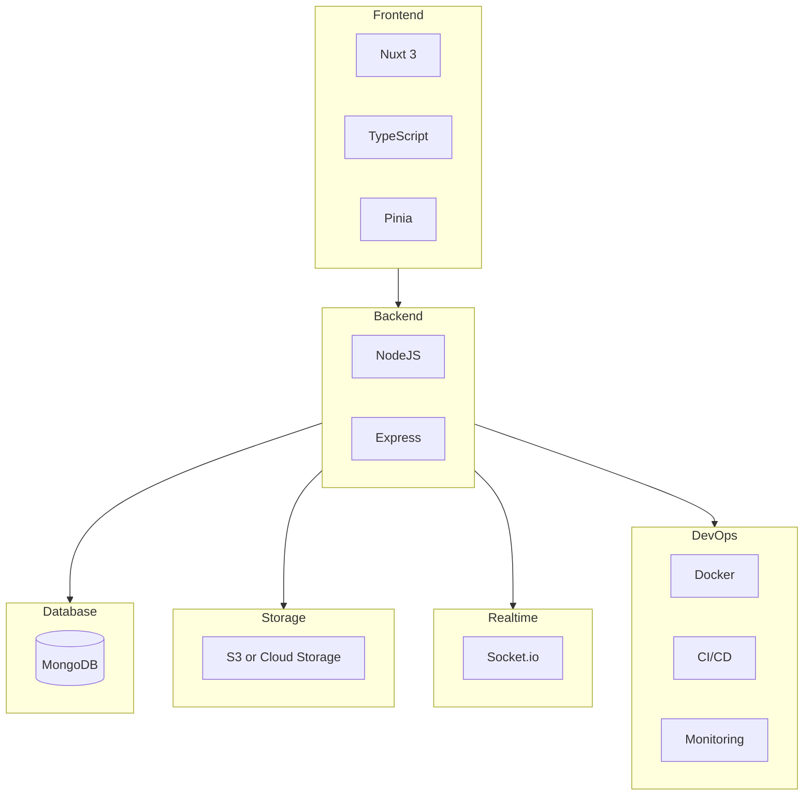
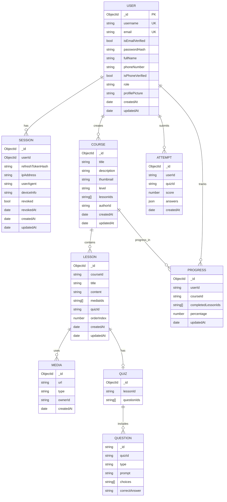
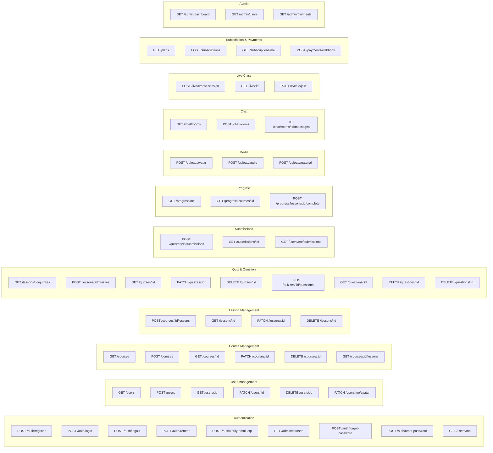
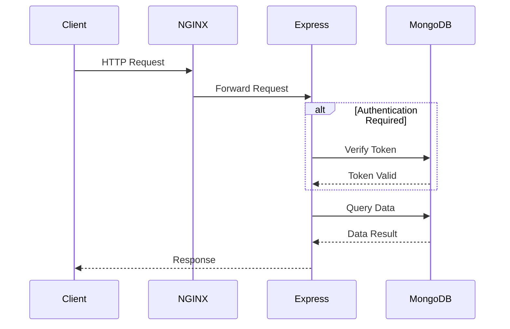

# Tài liệu kiến trúc hệ thống

Tài liệu này mô tả kiến trúc tổng thể của hệ thống, bao gồm các thành phần chính,
cách chúng tương tác với nhau, và các nguyên tắc thiết kế cơ bản.

## Mục lục

---

## Tổng quan

To-do: Viết phần tổng quan về hệ thống, mục tiêu và phạm vi của tài liệu kiến trúc.

---

## Sơ đồ Use-case

---

## Kiến trúc hệ thống

### Kiến trúc cấp cao

### Các lớp kiến trúc

---

## Các công nghệ chính

---

## Lược đồ cơ sở dữ liệu

---

## Mô hình API

### RESTful API Endpoints

### BFF Endpoints

To-do: Cập nhật sau

### Luồng giao tiếp chính

---
